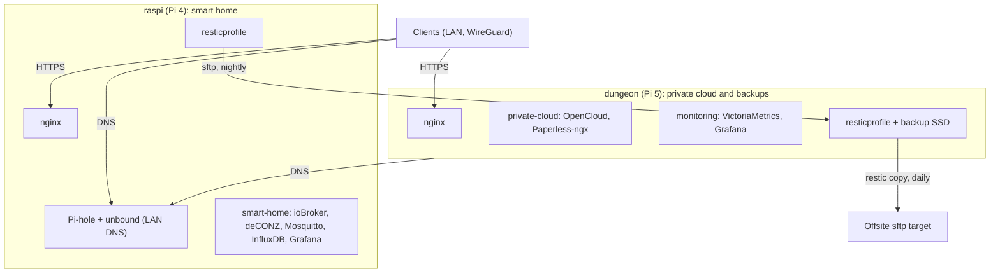
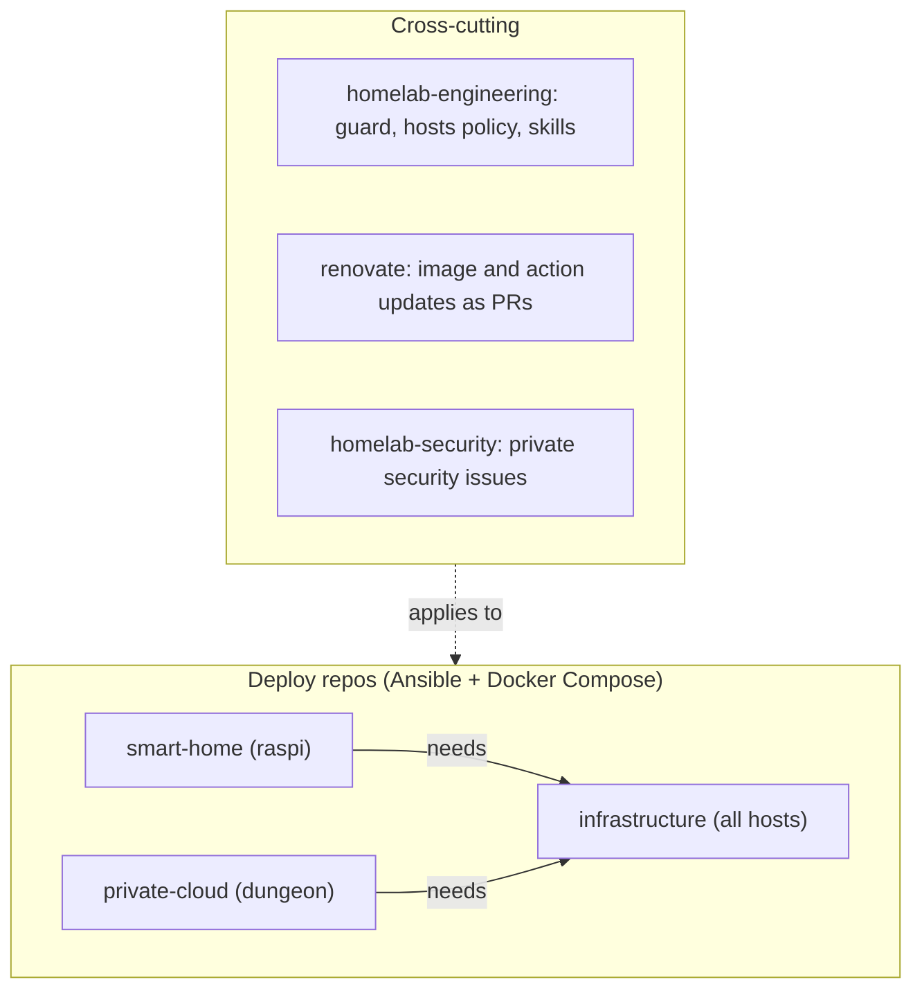

# Homelab architecture

How the homelab fits together: hosts, shared services, app stacks and the repos that deploy them. Details live in
each repo's README; this page is the map. Keep it in sync when a host, a stack or a repo's role changes.

## Hosts

Three Raspberry Pis (Debian/Raspberry Pi OS trixie, arm64), all in infrastructure's inventory. Production hosts
and the test host are also listed in [`claude/hooks/hosts.json`](claude/hooks/hosts.json).

| Host | Hardware | Role | Stacks |
| --- | --- | --- | --- |
| `raspi` | Raspberry Pi 4, Argon ONE V2 case | Production: smart home, LAN DNS for all hosts | infrastructure (with LAN Pi-hole), smart-home |
| `dungeon` | Raspberry Pi 5 (8 GB), NVMe, USB backup SSD | Production: private cloud, backup target, central monitoring | infrastructure (no LAN Pi-hole, plus `monitoring`), private-cloud |
| `testbench` | Raspberry Pi | Integration runs before any production rollout | infrastructure, smart-home (no deCONZ), private-cloud |

Nothing is exposed to the internet: clients reach the hosts from the home network or through WireGuard.

testbench mirrors raspi plus private-cloud and backs up to dungeon too (its copy stays at home).

## Shared services (infrastructure)

| Area | How it works |
| --- | --- |
| Networks | `siz` is internal (no internet); nginx reaches the web UIs through it. Containers that need the internet also join `outbound` and resolve through the `outbound` Pi-hole, which acts as an egress filter. |
| DNS | The LAN Pi-hole on raspi forwards to unbound (recursive, DNSSEC). Records, lists, groups and clients come from `configs/pihole.yaml` through `setup-pihole.yaml`. |
| TLS | A private root CA in KeePass signs one certificate per host; `check-certificates.yaml` renews it 30 days before expiry. Each host terminates TLS for its own services, one vhost per web UI (`<service>.<host>`). |
| Secrets | One KeePass database per host, read by the `keepass` lookup plugin; the `secrets` role writes `.env` files and Compose secret files below `/etc/docker/`. No ansible-vault. |
| Backups | resticprofile backs up `/home`, `/etc` and the Docker volumes nightly to dungeon's SSD; dungeon copies raspi's and its own repository offsite daily. Every stack restores its own state before its first `compose up` (clean-slate restore); a monthly drill checks the repositories. |
| Monitoring | healthmonitor reports unhealthy containers to Discord; Telegraf sends host and container metrics to VictoriaMetrics, Grafana on dungeon shows them. |

The stack is assembled from component roles (`reverse_proxy`, `portainer`, `unbound`, `pihole`, `outbound`,
`resticprofile`, `healthmonitor`, `landing_page`, `monitoring`, `monitoring_agent`), switched per host with
`stack_components`.

## App stacks

| Stack | Host | Services | Compose project |
| --- | --- | --- | --- |
| smart-home | raspi | ioBroker (two Redis), deCONZ + IKEA firmware downloader, InfluxDB, Telegraf, Grafana, Mosquitto | `smart-home` |
| private-cloud | dungeon | OpenCloud | `opencloud` |
| private-cloud | dungeon | Paperless-ngx with Postgres, Valkey, Gotenberg, Tika | `paperless` |

All images are pinned in the compose files and updated by Renovate.

## Repos

**Dependencies point one way: the app repos depend on infrastructure, never the reverse.**

| Repo | What | Notes |
| --- | --- | --- |
| [infrastructure](https://github.com/TheRealArthurDent/infrastructure) | Host setup and shared services: playbooks `bootstrap`, `update`, `check-certificates`, `setup-pihole`, `setup-grafana` | Successor of the private `raspberry` repo (older issues there) |
| [smart-home](https://github.com/TheRealArthurDent/smart-home) | The smart home stack, role `smart_home`, Grafana provisioning | No KeePass access of its own; reads only `MOSQUITTO_PASSWD` from the `.env` infrastructure writes |
| [private-cloud](https://github.com/TheRealArthurDent/private-cloud) | OpenCloud and Paperless-ngx, one role and Compose project each | New apps use Compose secrets instead of `.env` |
| [homelab-engineering](https://github.com/TheRealArthurDent/homelab-engineering) | Shared Claude Code config, setup scripts, `github-settings.sh` | This repo |
| [renovate](https://github.com/TheRealArthurDent/renovate) | Self-hosted Renovate runs (GitHub Actions) and the shared config | Majors always as PRs |
| [homelab-security](https://github.com/TheRealArthurDent/homelab-security) | Private: findings, incident notes, rotation records | Fixes land in the public repos with neutral wording; no secrets here either |

## Changing things

- **Rollout**: test host first (`--check --diff`, real run, second run with `changed=0`), then production. Every
  playbook needs `--limit <host>`. The user runs everything against the Pis.
- **New host from scratch**: infrastructure's `ansible/README.md`, "Set up a host": bootstrap, certificate, stack
  (restores its state), Pi-hole, then each app stack (restores its volumes).
- **Cross-repo changes**: a new app, secret, volume or web UI needs infrastructure first (secret, vhost, SAN, Pi-hole
  record, `stack_backup_stacks`), merged and rolled out before the app PR. See the
  [`cross-repo-changes`](claude/skills/cross-repo-changes/SKILL.md) skill.
- **CI**: each deploy repo runs pytest, Molecule and `ansible-lint --strict` on every PR; required checks are in
  `.github/rulesets/`, applied with `github-settings.sh`.
